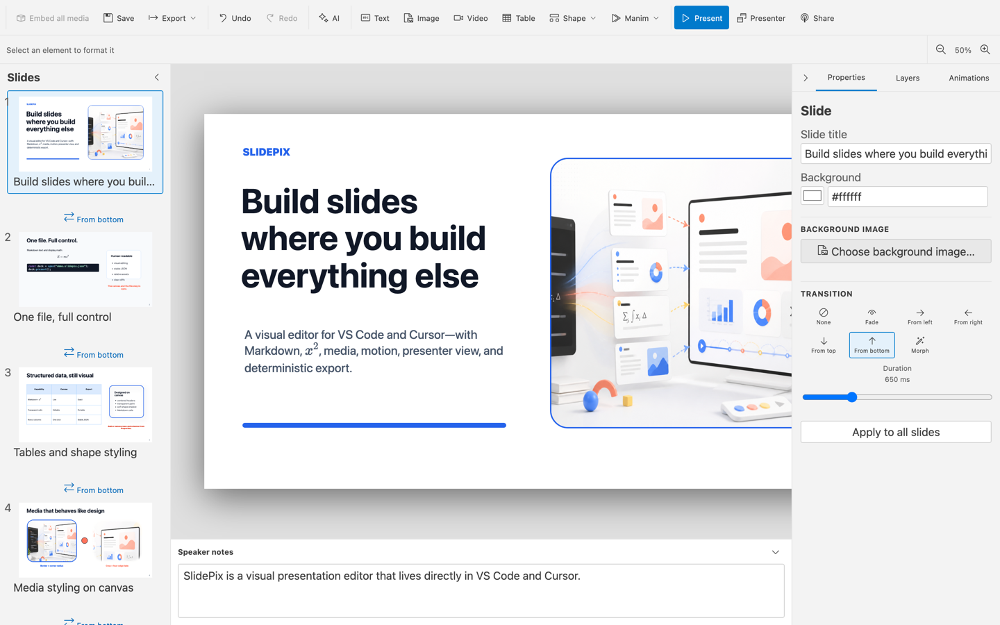
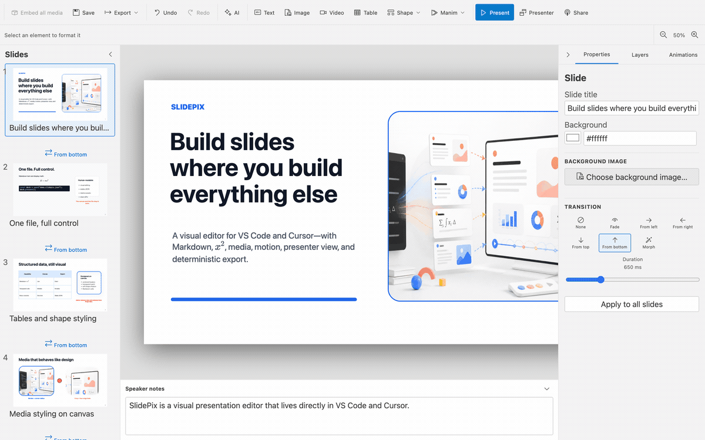
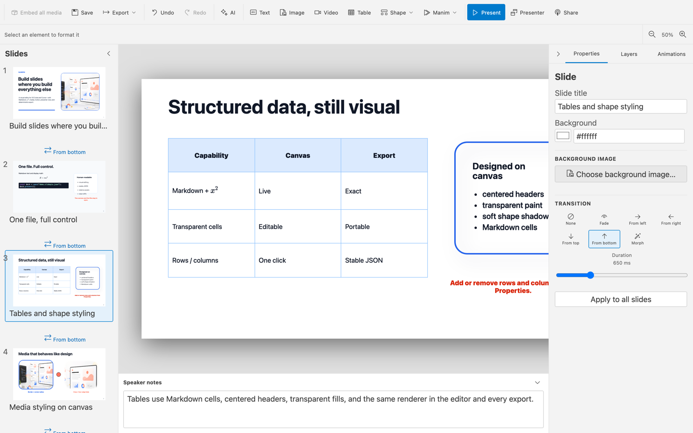
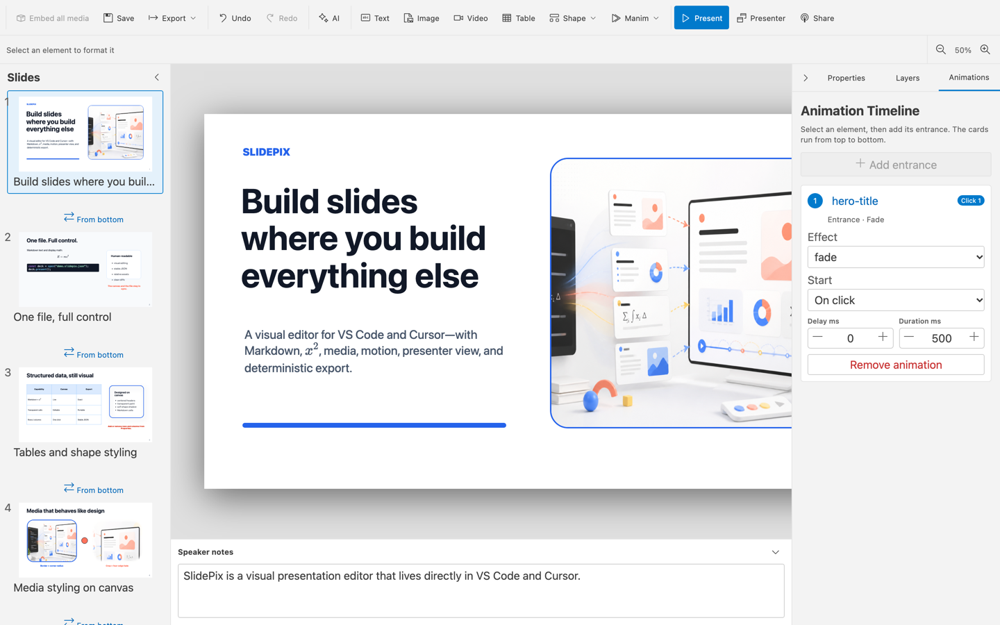
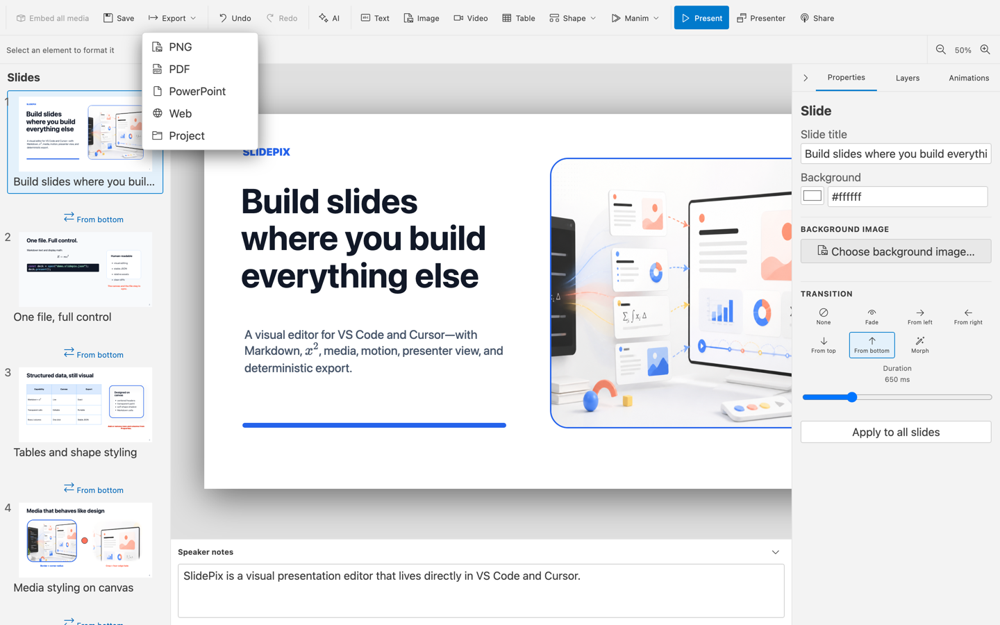

# SlidePix Deck

SlidePix is a visual presentation editor for desktop VS Code, Cursor, and their forks. A presentation is a readable `*.slidepix.json` file, with pictures and videos in a sibling folder.




## Install the extension

[Visual Studio Marketplace](https://marketplace.visualstudio.com/items?itemName=AntoinePERRIN.slidepix-deck)
[Open VSX Registry](https://open-vsx.org/extension/antoineperrin/slidepix-deck)


## Create a deck

1. Open the Command Palette (`Ctrl+Shift+P` on Windows and Linux, `Cmd+Shift+P` on macOS).
2. Run **SlidePix: Create Deck**.
3. SlidePix writes `untitled.slidepix.json` next to the file selected in Explorer, or in the workspace folder, and opens the visual editor.

If a deck opens as JSON, right-click the tab and choose **Reopen Editor With… → SlidePix Editor**.

## What you are looking at

- **Left:** slide previews. Drag to reorder. Use the gap between slides to insert a slide or set the incoming transition.
- **Center:** the current slide. Click an item to move, resize, or rotate it. Double-click text to edit it on the slide, or an image to crop it.
- **Top:** add text, images, videos, tables, shapes, and Manim scenes. **Present**, **Presenter**, **Export**, and **Share** are on the same bar.
- **Right:** slide and item properties, layer order, and the animation timeline.
- **Bottom:** speaker notes. Save with `Ctrl+S` or `Cmd+S`. Undo and redo use the usual shortcuts and the toolbar buttons.



## Write on the slide

Add text with **Text** and type immediately. The contextual bar sets bold, italic, lists, alignment, font, size, and color. **Advanced editor** is for longer Markdown, inline and display LaTeX such as `$x^2$`, and fenced code.

Tables use Markdown cells. Add or remove rows and columns from **Properties**.



## Pictures, video, and shapes

Use **Image** or **Video**, or drag a file from Explorer. Workspace media stays linked by a relative path. **Embed all** copies it into the sibling `.assets` folder when the deck needs to travel.

Select an image to set its border, corner radius, and edge fade. Double-click it to crop: drag the picture to reposition it, and drag an edge to change the frame.

**Shape** adds rectangles, ellipses, and lines. Shift-click a second item to multi-select, then align or distribute from the contextual bar.

## Motion

Select an item and open **Animations** to add an entrance. The cards run from top to bottom. Set the incoming transition from the labelled gap between two slide previews, or from **Properties**. **Apply to all slides** copies that transition.



## Present

**Present** opens one audience window. The shortcut is `Ctrl+Shift+F5` (`Cmd+Shift+F5` on macOS).

**Presenter** keeps the current slide, the next slide, notes, and a timer beside the audience window.

## Export

Open **Export** in the toolbar.



| Format | What you get |
| --- | --- |
| **PNG** | One image of the current slide. The first export may ask to download a Chromium renderer. |
| **PDF** | The deck, with a video shown as its first frame and a play control. |
| **PowerPoint** | A native `.pptx`: editable text, highlighted code, equations, shapes, tables, pictures, video, transitions, and common animations. LibreOffice is not required. |
| **Web** | An offline folder with `index.html` and copied media. Open it in a browser or host it as static files. |
| **Project** | A zip of the deck, its `.assets` folder, and the linked media needed to open it elsewhere. |

Fonts are referenced, not bundled, so another computer may substitute a system font.

## Take the deck with you

Copy both items together:

```text
my-talk.slidepix.json
my-talk.assets/
```

The asset folder appears after media is imported. Its name has to match the deck.

## Work with Git

With a deck open, run **SlidePix: Configure Git Collaboration** and confirm the preview. SlidePix adds a repository-local merge driver that understands slide and element IDs. Changes to different slides combine. A real clash opens **SlidePix: Resolve Git Conflict**, where you pick base, ours, or theirs. **SlidePix: Remove Git Collaboration** removes only that setup.

## Edit together

**Share** copies a live invitation. The other person runs **SlidePix: Join Live Collaboration** and pastes it. You approve them, then both editors stay on the same deck until **Stop**.

## Ask an assistant to look

**AI**, or **SlidePix: Configure MCP**, installs the MCP server for Cursor, VS Code, Codex, Claude Code, and Claude Desktop, and copies the agent skills into the shared skill folders. The server is the extension's `dist/mcp.cjs`, started with the editor's Node. An existing SlidePix skill is replaced. Reload the MCP server if it was already connected, then start a new chat to list, inspect, and edit decks.

The longer guide for install, Git, live sessions, and export details is in the [SlidePix repository](https://github.com/antoineperrin25/slidepix).
